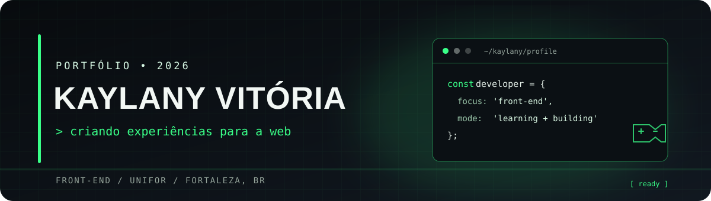

  

  <h1>Oi, eu sou a Kaylany 👋</h1>
  
<strong>Estudante na Universidade de Fortaleza · Desenvolvimento Front-end</strong>

  
Gosto de transformar ideias em experiências para a web e aprender construindo projetos.

  <a href="#projetos">Projetos</a> · <a href="#tecnologias">Tecnologias</a> · <a href="#github">GitHub</a>

---

## Sobre mim

- 🎓 Aluna na Universidade de Fortaleza (Unifor)
- 📍 Fortaleza, Brasil
- 💻 Explorando desenvolvimento web por meio de projetos pessoais e acadêmicos
- 🎮 Curto games — uma inspiração discreta para esta identidade visual

## Projetos em destaque

| Projeto | Sobre | Tecnologias no repositório |
| --- | --- | --- |
| [Barbie Landing Page](https://github.com/KaylanyVitoria/barbie-landing-page) | Landing page responsiva criada como desafio front-end. | HTML |
| [Unimusica Front-end](https://github.com/KaylanyVitoria/Unimusica-frontEnd) | Projeto de front-end desenvolvido em JavaScript. | JavaScript |
| [Desafio-5](https://github.com/KaylanyVitoria/Desafio-5) | Entrega recente em HTML, parte de uma sequência de desafios. | HTML |
| [Playlist](https://github.com/KaylanyVitoria/Playlist) | Projeto desenvolvido em Java. | Java |

[Ver todos os repositórios →](https://github.com/KaylanyVitoria?tab=repositories)

## Tecnologias

Linguagens identificadas nos meus repositórios públicos, agrupadas pelo tipo de projeto:

**Web**

  

**Outros projetos**

 

## GitHub

  
  

---

Construindo, aprendendo e evoluindo um commit de cada vez. ✨

